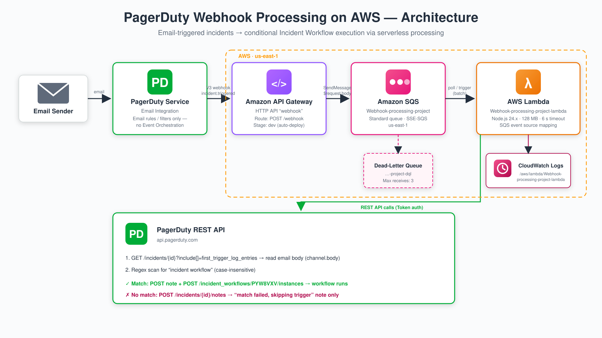
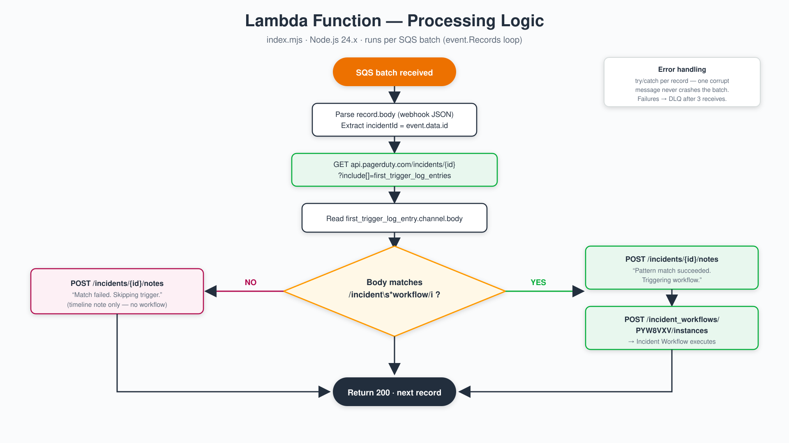

# PagerDuty Webhook Processing on AWS

A serverless AWS project that closes a real gap in PagerDuty: **service-level email integrations can't decide whether to run an Incident Workflow based on what's actually written in the email**. This project reads that email body back out via the PagerDuty REST API and conditionally triggers a workflow — entirely with AWS-managed, serverless components.

Built as a hands-on exploration of how a customer could implement this kind of custom automation using cloud compute, rather than just recommending it.

## The Problem

PagerDuty service-level email integrations do **not** go through Event Orchestration — only email filters and email management rules apply. Those rules can accept, reject, or deduplicate an incoming email, but they can't inspect the email's content and decide, based on that content, whether an Incident Workflow should run.

**Goal:** show how AWS can close that gap — process the outbound PagerDuty webhook, inspect the original email body, and act on the incident via REST API. The pattern generalizes to any "inspect payload → call API → act" automation.

## Architecture



1. A service-level email creates an incident in PagerDuty.
2. That incident fires a **V3 webhook** (`incident.triggered`) to an **API Gateway** HTTP API endpoint.
3. API Gateway forwards the payload directly into an **SQS** queue (no compute in between).
4. SQS triggers a **Lambda** function.
5. Lambda extracts the incident ID from the webhook, calls back to PagerDuty's REST API to fetch the incident (including the original email body), and decides whether to act.
6. **CloudWatch Logs** captures every step of that decision.

### Lambda decision logic



- Receive the webhook batch from SQS and extract the incident ID.
- `GET` the incident from PagerDuty, including `first_trigger_log_entries`, to read the email body.
- Regex-scan the body for the phrase `"incident workflow"` (case-insensitive).
- **Match:** `POST` a note to the incident, then `POST` to trigger the Incident Workflow via REST API.
- **No match:** `POST` a note documenting the failed match only — no workflow runs.

## Tech Stack — Deployed Configuration

Region: `us-east-1`

| Component | Configuration |
|---|---|
| **API Gateway** | HTTP API "webhook" · `POST /webhook` · stage `dev` · direct SQS `SendMessage` integration |
| **SQS** | Standard queue · SSE-SQS encryption · dead-letter queue after 3 failed receives |
| **Lambda** | Node.js 24.x · 128 MB · 2.2 kB package, zero dependencies · SQS event source mapping |
| **CloudWatch Logs** | Logs every decision step · ~3.7s duration · 104 MB max memory observed |

## PagerDuty Configuration

- **Service email integration** creates the incident (native — only email rules/filters apply).
- **V3 webhook subscription**: `incident.triggered` → API Gateway invoke URL.
- **Incident Workflow** ("Lambda Function" workflow) — runs via REST API on keyword match.
- A single **REST API token** authenticates all three of Lambda's calls: `GET` (read email body), `POST` (note), `POST` (trigger workflow).

## Validated Results

Tested end-to-end with a real incident:

- **Positive match** — email body contains "incident workflow" → automation note posted, then the Incident Workflow triggers via API. Confirmed on the incident timeline and in CloudWatch (batch received → incident ID captured → channel body found → match found → workflow triggered successfully).
- **Negative match** — email body without the keyword → only a "match failed, skipping trigger" note is posted; no workflow entry ever appears on the timeline.
- **Performance:** ~3.7s duration (billed ~3,789 ms), ~104/128 MB memory used.

## Lessons Learned

- **Lambda timeout:** the default 3-second timeout wasn't enough — the full round trip of PagerDuty API calls this function makes runs closer to 3.7 seconds. Had to raise it to 6 seconds, otherwise Lambda kills the function before the API responses come back. A good reminder that chaining multiple external API calls inside one Lambda invocation needs headroom beyond the default.

## Security Notes

- The PagerDuty API token and "from" email are read from environment variables (`PAGERDUTY_API_TOKEN`, `PAGERDUTY_FROM_EMAIL`) — never hardcoded. In a real deployment these should be backed by AWS Secrets Manager.
- The incoming `X-PagerDuty-Signature` HMAC (already available as an SQS message attribute) is not yet verified in Lambda — a natural next hardening step.
- Transport and at-rest encryption are already in place (HTTPS end to end, SSE-SQS).
- IAM roles follow least privilege: the Lambda execution role only needs SQS consume + CloudWatch Logs; the API Gateway role only needs `sqs:SendMessage` on this one queue.
- **Known issue, left intentionally unfixed:** the 404 fallback branch in `src/index.js` references a `triggerId` variable that's never declared. If that branch executes, it throws a `ReferenceError`, silently caught by the outer `try/catch`. Kept as an honest record of the code as originally deployed — fix before reusing that fallback path.

## Possible Improvements

- Verify the webhook signature before processing.
- Externalize the matching keyword (env var or a small config store) so it can change without a redeploy.
- Add CloudWatch-based alerting on failures.
- Fix the `triggerId` bug in the 404 fallback path noted above.

## Repository Structure

```
webhook-processing-project/
├── README.md
├── LICENSE
├── package.json
├── src/
│   └── index.js          — Lambda handler (sanitized: secrets via env vars)
├── diagrams/
│   ├── architecture.svg
│   └── lambda-logic.svg
└── docs/
    └── project-overview.pdf   — slide deck export (optional, add your own)
```

## Deployment Notes

Required Lambda environment variables:

| Variable | Description |
|---|---|
| `PAGERDUTY_API_TOKEN` | A PagerDuty REST API token (`Token token=...`) |
| `PAGERDUTY_FROM_EMAIL` | The email address used in the `From` header for note-creation calls |

Runtime: Node.js 24.x · Trigger: SQS event source mapping · Recommended timeout: 6 seconds.

## Acknowledgments

Special thanks to Nicolas Suarez from Rundeck Support for helping deploy this solution on the Rundeck AWS instance.

## Author

**Andrés Padrón**
